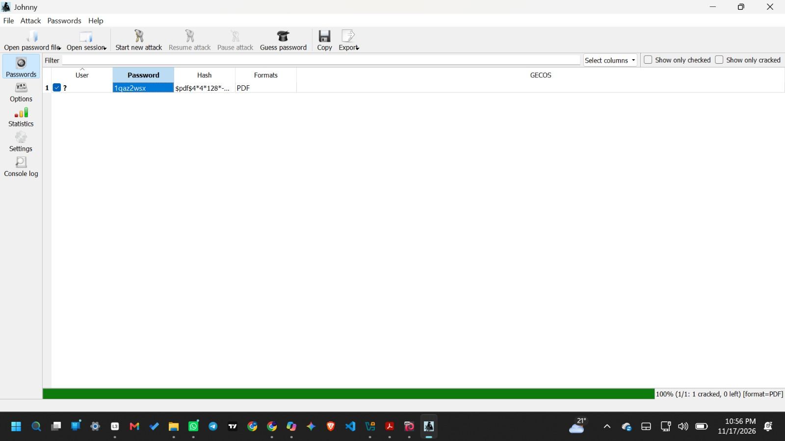

# 🔐 Week 3 Cybersecurity Assessment Report

## Password Assessment and Recovery using Johnny (John the Ripper GUI)

**Author:** Arnold Mumo Kilonzo  
**Internship:** NetworkWalks Cybersecurity Internship  
**Week:** 3

---

# 📌 Introduction

This project focused on password security assessment using **Johnny**, the graphical user interface (GUI) for **John the Ripper (JTR)**.

The objective of the exercise was to understand how password auditing tools evaluate password strength, analyze password hashes, and recover weak passwords from encrypted files. A protected PDF document was used as the target for this assessment.

The project demonstrated the importance of strong password policies and highlighted the relationship between passwords, hashes, and password security testing.

---

# 🎯 Objectives

- Understand password security concepts.
- Learn the role of password hashes.
- Extract a hash from an encrypted PDF file.
- Configure and use Johnny (John the Ripper GUI).
- Perform password recovery against a password hash.
- Validate the recovered password.
- Understand the importance of strong passwords.

---

# 🛡️ Understanding John the Ripper and Johnny

### John the Ripper (JTR)

John the Ripper is a password auditing and password recovery tool used by cybersecurity professionals to evaluate password strength and identify weak credentials.

### Johnny

Johnny is the graphical user interface for John the Ripper. It provides a user-friendly environment for managing password auditing tasks without relying on command-line interaction.

---

# 🔍 Project Workflow

The password assessment process followed these stages:

```text
Encrypted PDF File
         ↓
Hash Extraction
         ↓
Save Hash to Text File
         ↓
Load Hash into Johnny
         ↓
Start Password Assessment
         ↓
Password Recovery
         ↓
Open Protected PDF
```

---

# Step 1: Obtain the Encrypted PDF

A password-protected PDF document was provided for analysis.

### Purpose

The encrypted file served as the target resource for the password recovery assessment.

---

# Step 2: Extract the PDF Hash

The hash associated with the encrypted PDF file was extracted using an online PDF hash extraction utility.

### Purpose

Johnny and John the Ripper do not work directly against the PDF file itself. Instead, they analyze a hash representation of the password protection.

---

# Step 3: Save the Hash

The extracted hash was copied into a text file:

```text
hash1.txt
```

### Purpose

The hash file acts as the input source for Johnny and John the Ripper.

---

# Step 4: Load the Hash into Johnny

The hash file was imported using:

```text
Open Password File
```

within the Johnny interface.

### Purpose

This enables John the Ripper to begin analyzing the supplied password hash.

---

# Step 5: Start Password Assessment

A new password assessment attack was initiated using:

```text
Start New Attack
```

within Johnny.

The tool analyzed the password hash and attempted to identify the original password.

---

# Step 6: Password Recovery

### Screenshot



### Findings

The password associated with the protected PDF file was successfully recovered.

Recovered Password:

```text
1qaz2wsx
```

Hash Format:

```text
PDF
```

### Purpose

The successful recovery demonstrated how weak passwords can be identified through password auditing techniques.

---

# Step 7: Validation

The recovered password was used to unlock the encrypted PDF document successfully.

### Result

✅ Password recovery successful

✅ Protected PDF opened successfully

✅ Password validated

---

# 🔍 Key Findings

- Password hashes can be used to evaluate password strength.
- Weak passwords can be recovered more easily than strong passwords.
- Password auditing tools help identify credential weaknesses.
- Encrypted files rely heavily on the strength of the chosen password.
- Strong password policies are critical for security.

---

# 📚 Skills Acquired

Through this project, I gained practical experience in:

- Password Security Assessment
- Password Auditing
- John the Ripper Fundamentals
- Johnny GUI Usage
- Hash Analysis
- Password Recovery Concepts
- Credential Security
- Password Hash Management
- PDF Security Testing
- Cybersecurity Documentation
- Technical Reporting

---

# 🔐 Security Lessons Learned

This exercise demonstrated the importance of:

- Using strong passwords.
- Avoiding predictable password patterns.
- Implementing password complexity requirements.
- Understanding the role of hashing in password security.
- Regularly assessing password strength through authorized security reviews.

---

# 🎓 Conclusion

This project provided practical exposure to password security assessment using Johnny and John the Ripper.

By extracting a password hash from an encrypted PDF document and conducting a password recovery assessment, I gained a deeper understanding of password auditing techniques and the importance of strong password selection. The exercise reinforced how weak passwords can create security risks and how cybersecurity professionals use password assessment tools to improve organizational r

**Arnold Mumo Kilonzo**

Bachelor of Science in Information Technology  
University of Embu

### Areas of Interest

- Cybersecurity
- Network Administration
- Ethical Hacking
- Linux Administration
- Security Operations (SOC)
- Artificial Intelligence
